<div align="center">

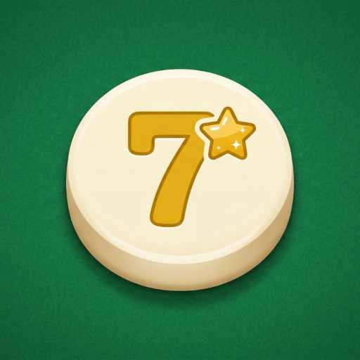

# Mesa Comum

**Monte combinações. Roube as dos amigos.**

Um jogo de mesa multiplayer no navegador, da família do rummy, onde toda combinação na mesa tem dono, e dá pra tomar a dos outros reorganizando as peças.


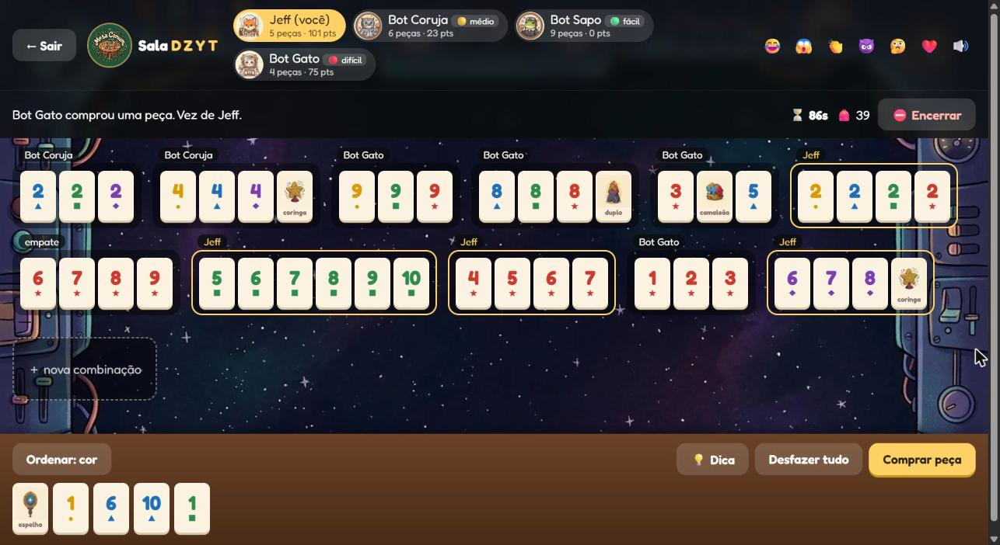

</div>

---

## Sumário

- [A ideia](#a-ideia)
- [Como jogar](#como-jogar)
- [Peças especiais](#peças-especiais)
- [Modos, temas e bots](#modos-temas-e-bots)
- [Tudo o que o jogo tem](#tudo-o-que-o-jogo-tem)
- [Galeria](#galeria)
- [Rodando na sua máquina](#rodando-na-sua-máquina)
- [Como funciona por dentro](#como-funciona-por-dentro)
- [Limitações e próximos passos](#limitações-e-próximos-passos)
- [Créditos](#créditos)
- [Licença](#licença)

---

## A ideia

Jogos da família do rummy são ótimos: você forma **trincas** e **sequências** com peças numeradas e pode reorganizar a mesa inteira na sua vez. Só que, depois que uma combinação vai pra mesa, ela é "de todo mundo".

A **Mesa Comum** muda isso com uma regra:

> **Cada combinação na mesa pertence a quem baixou mais peças nela.**

De repente, reorganizar a mesa vira um ataque. Tirar o 6 da sequência de um amigo e juntar com o seu 7 e 8 rouba os pontos dele. Grudar uma peça na trinca de alguém pode dar a ele pontos de graça. E a pontuação no fim conta **o que é seu na mesa**, não só quem esvaziou a mão primeiro.

---

## Como jogar

| | |
|---|---|
| **Peças** | Números de **1 a 10** em **5 cores**, 2 cópias de cada (100 peças), mais as [especiais](#peças-especiais). Cada cor também tem um símbolo (● ▲ ■ ◆ ★), pra quem não distingue bem as cores. |
| **Mão inicial** | 12 peças (8 na partida rápida). |
| **Trinca** | Mesmo número, cores todas diferentes, de 3 a 5 peças. Ex.: `7● 7▲ 7■` |
| **Sequência** | Mesma cor, números seguidos, 3 ou mais peças. Ex.: `4◆ 5◆ 6◆ 7◆` |
| **Sua vez** | Reorganize a mesa como quiser e baixe peças da mão. No fim, **todas** as combinações precisam estar válidas. Se não baixar nada, você compra 1 peça. |
| **Tempo** | Cada vez tem um relógio (90s no modo normal). Se acabar, você compra automaticamente. |
| **Dono** | Cada combinação é de quem baixou **mais peças** nela. Empate = ninguém é dono. |
| **Roubo** | Reorganize a mesa até ficar com a maioria de uma combinação, e ela passa a ser sua. |
| **Fim** | Quando alguém esvazia a mão, ou quando o saco acaba e ninguém mais consegue jogar. |
| **Pontos** | Soma das combinações que você domina − o que sobrou na sua mão. Quem esvaziou a mão ganha **+10**. |

Enquanto você mexe nas peças, cada combinação mostra **na hora** se é válida e de quem vai ser, então dá pra ver o roubo acontecendo antes de confirmar. Se algo estiver errado, ela diz o motivo:

<div align="center">
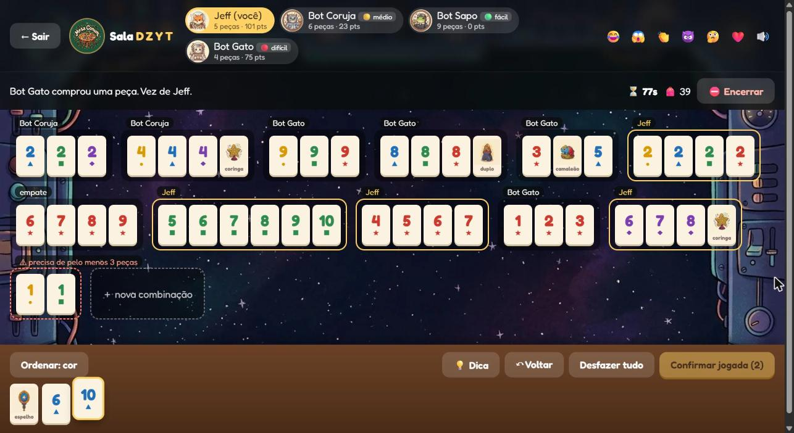
<br><sub>Uma combinação em vermelho avisa "precisa de pelo menos 3 peças", e o botão de confirmar só libera quando tudo estiver válido.</sub>
</div>

---

## Peças especiais

São 5 por partida (15 no modo Caos). Valem **5 pontos**, podem mudar de combinação na mesa, mas não voltam pra mão.

| | Peça | O que faz | Exemplo |
|:-:|---|---|---|
| 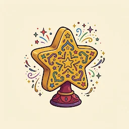 | **Coringa** (×2) | Vale qualquer peça. | `3 · coringa · 5` |
| 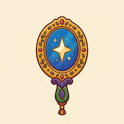 | **Espelho** | Fica no meio de uma combinação refletida, usando as 2 cópias de cada peça. | `3 4 5 · espelho · 5 4 3` |
| 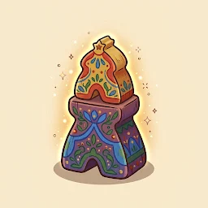 | **Duplo** | Vale 1 **ou** 2 peças, então fecha um buraco duplo. | `3 · duplo · 6` |
| 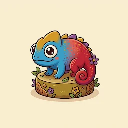 | **Camaleão** | Numa sequência, ocupa uma posição e troca a cor dali pra frente. | `3🔵 4🔵 · camaleão · 6🔴 7🔴` |

---

## Modos, temas e bots

### Modos

| Modo | Mão | Tempo por vez | Especiais |
|---|:-:|:-:|:-:|
| ⏱️ **Normal** | 12 | 90s | 5 |
| ⚡ **Rápida** | 8 | 45s | 5 |
| 🌀 **Caos** | 12 | 90s | 15 |

### Temas

O tema vale pra **sala inteira**: todo mundo vê o mesmo fundo e os mesmos avatares. Cada tema tem 4 bichinhos fantasiados, um por lugar na mesa.

| Tema | Raposa | Coruja | Sapo | Gato |
|---|:-:|:-:|:-:|:-:|
| 🟩 **Feltro** |  |  | 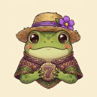 |  |
| 🍺 **Taverna** |  | 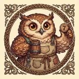 | 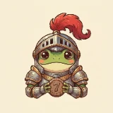 |  |
| 🏖️ **Praia** |  |  |  |  |
| 🚀 **Espaço** |  |  |  |  |

### Bots

Dá pra completar a mesa com até 3 bots, cada um com seu nível:

| Nível | Como joga |
|---|---|
| 🟢 **Fácil** | Baixa uma coisa por turno e nunca usa especiais. |
| 🟡 **Médio** | Baixa tudo o que consegue e usa coringas pra completar pares. |
| 🔴 **Difícil** | Testa cada jogada possível, inclusive **pegar uma peça emprestada** da combinação de outro jogador pra montar uma sua, e escolhe a que mais puxa os pontos pro lado dele. Rouba de propósito e nunca dá pontos de graça. |

O botão **💡 Dica** usa o mesmo cérebro do bot Difícil pra montar uma sugestão na sua mesa. Você confirma, ajusta ou volta.

---

## Tudo o que o jogo tem

**Na mesa**
- Arrastar e soltar com **mouse ou dedo**. No celular, a peça segue o dedo um pouco acima dele, o destino acende e o celular dá uma vibradinha.
- Tocar e tocar também funciona: toca na peça, depois no destino.
- **↶ Voltar** desfaz um movimento por vez, e **Desfazer tudo** volta pro começo do turno.
- Ordenar a mão por cor ou por número.
- As peças baixadas na última jogada ficam brilhando, pra todo mundo ver o que mudou.

**Clima de jogo**
- Aviso grande nos roubos: *"😈 Ana tirou 12 pts de Bruno!"*
- Sons próprios pra cada evento, gerados pelo navegador (sem arquivos de áudio), com botão pra silenciar.
- Reações rápidas (😂 😱 👏 😈 🤔 ❤️) que sobem do avatar de quem mandou.
- **Pódio** no fim, com 🥇🥈🥉, confete e os **melhores momentos**: maior roubo, maior jogada e quem mais roubou.

**Sala**
- Código de 4 letras e link de convite.
- O **dono** (quem criou) pode encerrar a partida, com confirmação.
- **← Sair** a qualquer momento. No meio da partida você mantém o lugar e pode voltar com o código.
- Se alguém cair, as vezes dele passam sozinhas depois de 5 segundos.
- Atualizar a página (F5) não perde o lugar.

**Acessibilidade e celular**
- Cada cor tem um símbolo, além da cor.
- Respeita "reduzir movimento" do sistema: sem animações nem confete.
- Layout próprio pra telas pequenas.
- Dá pra instalar como app no celular (manifest e ícone próprios).

---

## Galeria

<table>
<tr>
<td width="50%">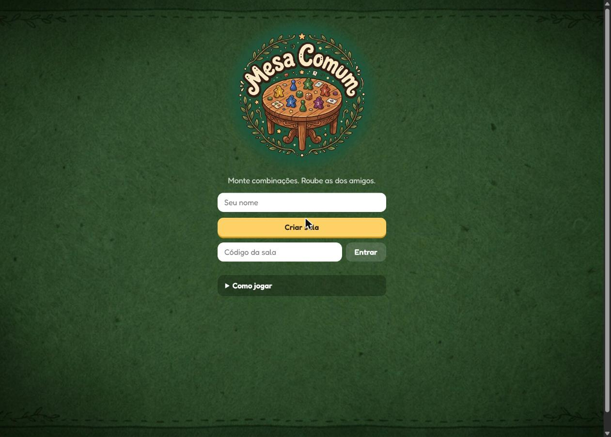<br><sub><b>Tela inicial</b>: criar sala ou entrar com código.</sub></td>
<td width="50%">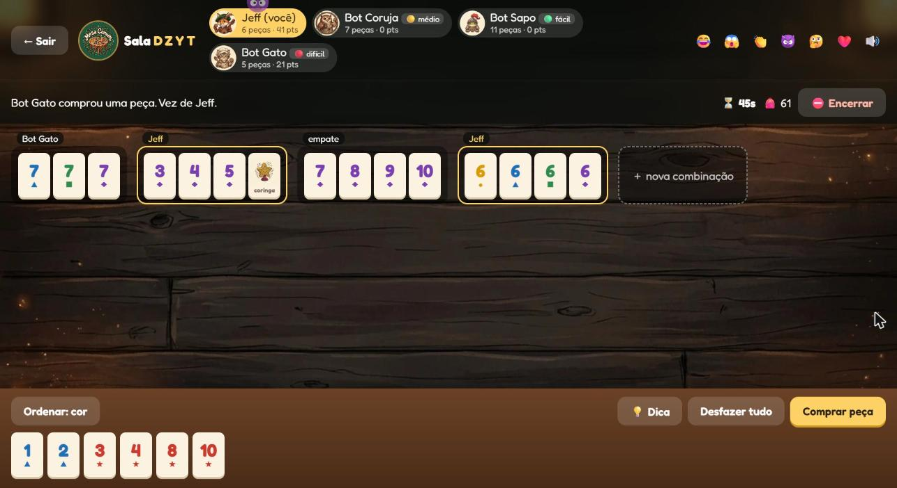<br><sub><b>Tema Taverna</b>, numa partida rápida contra 3 bots.</sub></td>
</tr>
<tr>
<td>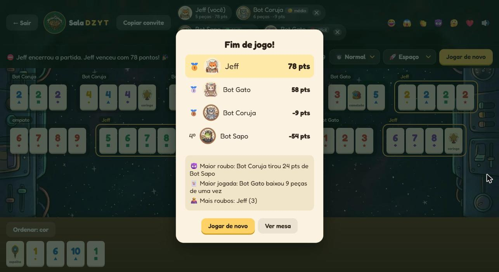<br><sub><b>Pódio</b> com os melhores momentos da partida.</sub></td>
<td>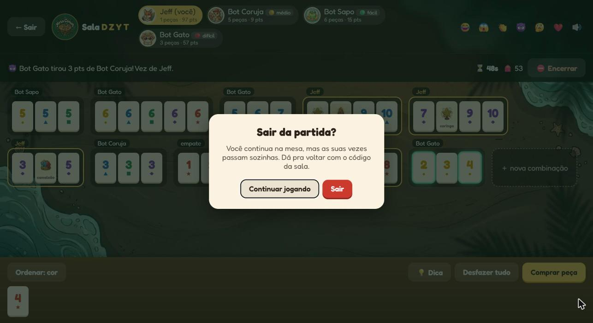<br><sub><b>Confirmações</b> no estilo do jogo, com o lado seguro em foco.</sub></td>
</tr>
</table>

<div align="center">
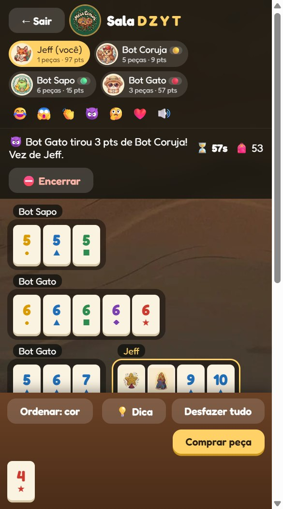
<br><sub><b>No celular</b>, tema Praia: cabeçalho compacto e a mão que nunca cobre a mesa.</sub>
</div>

---

## Rodando na sua máquina

Você só precisa do **[.NET 10 SDK](https://dotnet.microsoft.com/download)**. Nenhum pacote NuGet, nenhum `npm install`.

```bash
git clone https://github.com/jeffersonmds/mesa-comum.git
cd mesa-comum
dotnet run
```

Abra o endereço que aparecer no terminal (algo como `http://localhost:5000`), crie uma sala e:

- **Jogar sozinho:** clique em **+ Bot** (até 3) e em **Começar partida**.
- **Testar o multiplayer numa máquina só:** abra o convite numa **segunda aba**, porque cada aba conta como um jogador.
- **Jogar com amigos na mesma rede Wi-Fi:**
  ```bash
  dotnet run --urls http://0.0.0.0:5000
  ```
  e todo mundo abre `http://IP-DO-SEU-PC:5000`.

### Testes

As regras têm uma checagem própria, sem framework de testes:

```bash
dotnet run -- --selftest
```

Ela cobre a validação das combinações (com todos os especiais), o dono e os roubos, a pontuação, os 3 níveis de bot, o tempo esgotado, a dica, o encerramento pelo dono e a saída de jogadores. Se algo quebrar, ela diz qual regra falhou.

---

## Como funciona por dentro

O projeto é pequeno de propósito: **um arquivo de servidor e uma página**.

```
mesa-comum/
├── Program.cs             # regras, bots, salas e tempo real (servidor inteiro)
├── MesaComum.csproj
└── wwwroot/
    ├── index.html         # a página inteira: HTML, CSS e JS sem framework
    ├── manifest.webmanifest
    └── img/               # especiais, logo, ícones e uma pasta por tema
```

### O servidor manda

O navegador **nunca decide** se uma jogada vale. O servidor guarda a partida, valida tudo e manda pra cada jogador a sua própria visão da mesa: todo mundo vê a mesa, mas só você vê a sua mão.

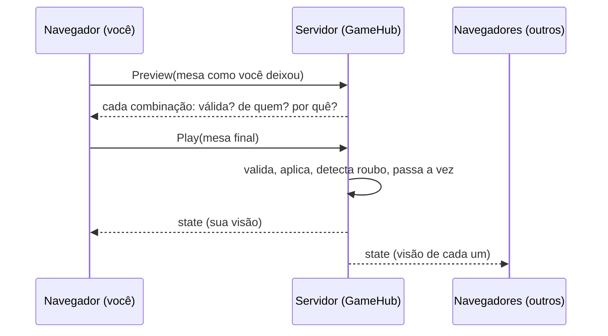

- **Tempo real:** ASP.NET Core + **SignalR**, que já vêm no .NET, sem pacote extra.
- **Uma fonte de regras:** a página pergunta ao servidor (`Preview`) se cada combinação vale e de quem fica, então as regras existem num lugar só (`Rules.Why`, em `Program.cs`).
- **Relógio do servidor:** um timer de meio segundo faz os bots jogarem e passa a vez de quem estourou o tempo ou caiu.
- **Salas em memória:** salas paradas há 3h são apagadas, e o servidor aceita no máximo 200 ao mesmo tempo, pra um link público não encher a memória.

### O bot

O planejador (`Rules.Plan`) é o mesmo pros bots e pra 💡 Dica. A cada passo ele gera as jogadas possíveis:

1. montar uma combinação nova só com peças da mão;
2. encaixar uma peça da mão numa combinação da mesa;
3. *(Difícil)* **pegar uma peça emprestada** de uma combinação que continua válida sem ela e montar uma nova em volta dela.

O Difícil dá uma nota pra cada posição: **seus pontos na mesa − pontos dos outros − o que sobra na mão (+10 se esvaziar)**. Ele escolhe sempre a jogada que mais melhora essa nota, e por isso rouba de propósito e não alimenta ninguém. É guloso, um passo de cada vez, então decide rápido sem travar o servidor.

### A página

Sem framework: um `index.html` com CSS e JavaScript puros.
- O arrastar usa *pointer events*, então o mesmo código serve pro mouse e pro dedo (o arrastar nativo do HTML não funciona no toque).
- Os sons são sintetizados com a Web Audio API.
- Cada aba guarda um token no `sessionStorage`, o que permite recuperar o lugar depois de atualizar a página.

### A arte

Todas as artes (logo, peças especiais, fundos e os 16 avatares) foram geradas com o **Google Flow** (Nano Banana), no mesmo estilo e com o fundo creme das peças.

---

## Limitações e próximos passos

- **As salas vivem na memória.** Se o servidor reiniciar, as partidas somem.
- **Ainda não está hospedado:** pra jogar com amigos de longe, é preciso rodar com um túnel (tipo Cloudflare Tunnel) ou subir num serviço de hospedagem.
- **O bot Difícil é guloso:** ele não planeja vários passos à frente.

Ideias pra frente: missões secretas pra cada jogador, eventos de rodada ("Maré roxa: roxo vale dobro"), ranking e conquistas salvos.

---

## Créditos

Feito por **[Jefferson](https://github.com/jeffersonmds)**, com a ajuda do [Claude Code](https://claude.com/claude-code).

Inspirado nos jogos da família do rummy. As regras de posse e roubo, as peças especiais e toda a arte são próprias deste projeto.

---

## Licença

[MIT](LICENSE): pode usar, copiar, modificar e distribuir à vontade, inclusive em projetos comerciais, desde que mantenha o aviso de copyright e a licença.
